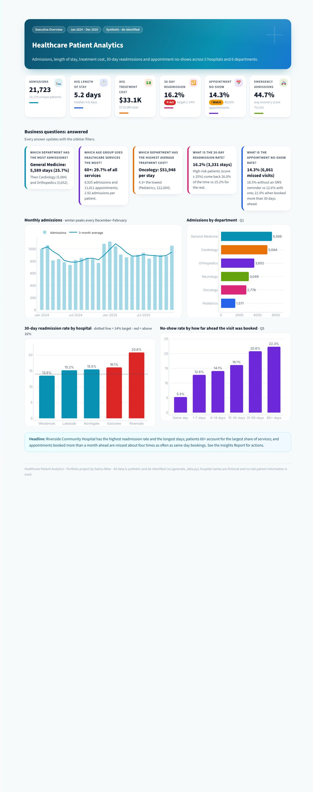
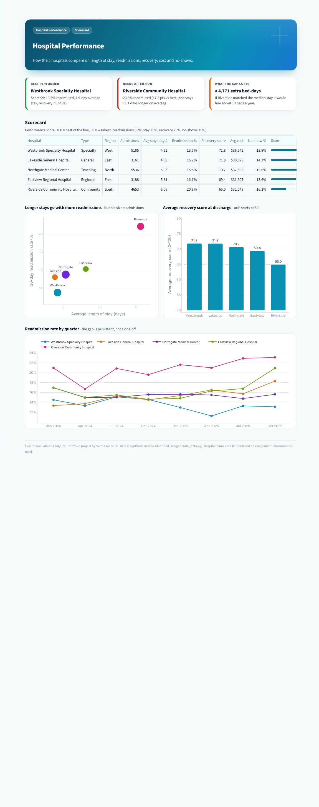
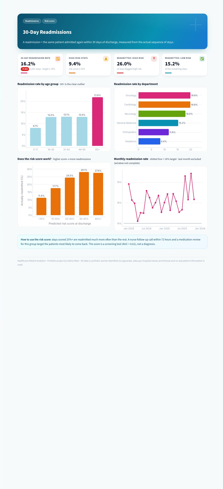
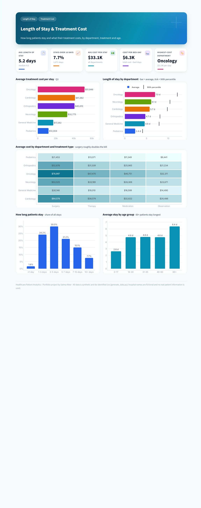
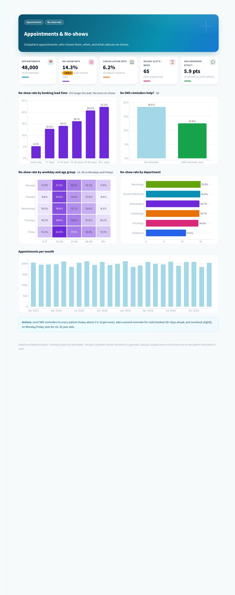

# 🏥 Healthcare Patient Analytics

**Admissions · Hospital performance · Length of stay · Treatment cost · 30-day readmissions · Appointment no-shows**

Python (pandas, NumPy) · PostgreSQL · Excel · Power BI · Streamlit / Plotly

**Live dashboard:** https://salmaakter.me/healthcare/

> **Data privacy:** this project uses **synthetic, de-identified data only**. Every row is generated by
> `src/generate_data.py` from a fixed random seed. Hospital names are fictional and `patient_key`
> values are random IDs. No real patient information is used anywhere.



---

## Business questions — answered

| Question | Answer |
|---|---|
| Which department has the most admissions? | **General Medicine**: 5,589 stays (25.7%), then Cardiology and Orthopedics |
| Which age group uses healthcare services the most? | **60+**: 29.7% of all services (stays + appointments), 2.92 stays per patient |
| Which department has the highest average treatment cost? | **Oncology**: $51,948 per stay, 4.3× Pediatrics |
| What is the 30-day readmission rate? | **16.2%** (target 14%); high-risk patients 26.0% vs 15.2% |
| What is the appointment no-show rate? | **14.3%**; 18.5% without an SMS reminder vs 12.6% with one |

**Headline findings** (full detail in the [Healthcare Insights Report](reports/Healthcare_Insights_Report.md))

* **Riverside Community Hospital** readmits 20.8% of patients vs 13.5% at Westbrook and keeps them 1.1 days
  longer. Matching the median stay would free about 4,800 bed-days.
* **Patients 60+** stay 6.4 days on average and are readmitted 21.8% of the time.
* **No-shows rise with waiting time:** 5.3% for same-day bookings vs 21.0% when booked more than 30 days ahead.
* **Winter peak:** admissions are 25% higher in December–February (General Medicine and Pediatrics).

## Analyses

| Analysis | Where |
|---|---|
| Patient admissions (trend, seasonality, department mix) | Dashboard → Executive Overview · SQL 1, 6, 7 |
| Hospital performance (scorecard, LOS vs readmissions) | Dashboard → Hospital Performance · SQL 8, 10 |
| Length of stay | Dashboard → Length of Stay & Cost · SQL 9, 10 |
| Treatment cost (by department and treatment) | Dashboard → Length of Stay & Cost · SQL 3, 11 |
| Readmission rate (age, department, risk score) | Dashboard → Readmissions · SQL 4, 12, 13 |
| Department analysis | every page (Department filter) · SQL 1, 18 |
| Patient demographics (age group, gender, insurance) | Dashboard → Patient Demographics · SQL 2, 14 |
| Appointments & no-shows (lead time, SMS, weekday) | Dashboard → Appointments & No-shows · SQL 5, 15–17 |

## Project outputs

| Output | File |
|---|---|
| **Healthcare Analytics Dashboard** (7 pages, filters, mobile-friendly) | `streamlit_app.py`, `app/` · live link above |
| **SQL Database** (PostgreSQL star schema + 18 business queries + views) | `sql/01_schema.sql` … `sql/04_views_for_power_bi.sql`, results in `docs/sql_results.txt` |
| **Python Data Cleaning** (22 logged steps) | `src/clean_data.py`, log in `docs/cleaning_log.csv` |
| **Excel Patient Dataset Cleaning** (raw problems highlighted, formula KPIs) | `excel/Healthcare_Patient_Data_Cleaning.xlsx` |
| **Power BI Healthcare Dashboard kit** (star schema CSVs, DAX, theme, page guide) | `powerbi/` |
| **Healthcare Insights Report** | `reports/Healthcare_Insights_Report.md` |

## Data model

```
dim_hospital ─┐                     ┌─ dim_patient (de-identified)
dim_department┼── fact_admission ───┤
dim_date ─────┘   21,723 stays      └─ readmitted_30d derived from each patient's stay sequence
dim_hospital / dim_department / dim_patient / dim_date ── fact_appointment (48,000)
```

| Table | Rows | Key columns |
|---|---|---|
| hospitals | 5 | hospital_id, name, region, beds, type |
| patients | 14,000 | patient_key, gender, age_group, region, insurance_type |
| admissions | 21,723 | department, visit_type, treatment_type, length_of_stay_days, treatment_cost, recovery_score, readmission_risk, readmitted_30d |
| appointments | 48,000 | department, appointment_datetime, lead_time_days, sms_reminder, status (Attended / No-show / Cancelled) |

The admissions table keeps the columns of the original sample file and adds hospitals, appointments and
actual readmissions (a readmission = the same patient admitted again within 30 days of discharge).
Stays discharged in the last 30 days of data are left out of the readmission rate because their 30-day
window is not complete yet.

## Data cleaning (Python)

The raw export (`data/raw/`) contains the problems real hospital exports have. `src/clean_data.py` fixes
them and logs every step:

* exact duplicate rows from a double export (admissions, appointments, patients)
* department label variants (`Cardio`, `Gen Med`, `Paediatrics`, trailing spaces)
* gender coded `M` / `F` / lower case / blank → Male / Female / Unknown (not guessed)
* two date formats (ISO and US `MM/DD/YYYY`) from two source systems
* admit and discharge dates entered the wrong way round → swapped back, stay recalculated
* treatment cost stored as text (`$12,345.00`) → number; missing cost → median of the same department + treatment, flagged
* readmission risk typed as a percentage (`34` → `0.34`)
* Pediatrics stays coded as age 60+ → age taken from the patient master table
* appointment status variants (`No Show`, `NS`, `no-show`) and negative lead times

## SQL highlights

* window functions: `LEAD()` to derive readmissions, `LAG()` for month-over-month change, moving averages, `RANK()`
* `percentile_cont` for median and 90th-percentile length of stay, `FILTER` for pivot tables
* the readmission rate is **recomputed in SQL and matches the Python result exactly** (query 4)

```sql
WITH seq AS (
  SELECT discharge_datetime,
         LEAD(admit_datetime) OVER (PARTITION BY patient_key ORDER BY admit_datetime) AS next_admit
  FROM fact_admission)
SELECT round(100.0 * avg(coalesce(next_admit - discharge_datetime
             BETWEEN interval '0' AND interval '30 days', false)::int), 1) AS readmission_rate_pct
FROM seq
WHERE discharge_datetime <= (SELECT max(admit_datetime) FROM fact_admission) - interval '30 days';
```

## Run it yourself

```bash
pip install -r requirements.txt
python src/generate_data.py      # synthetic raw export  -> data/raw/
python src/clean_data.py         # cleaning              -> data/clean/ + docs/cleaning_log.csv
python src/build_excel.py        # Excel workbook        -> excel/
python src/build_powerbi_kit.py  # Power BI files        -> powerbi/
python src/build_report.py       # insights report       -> reports/
streamlit run streamlit_app.py   # dashboard             -> http://localhost:8501

# PostgreSQL
createdb healthcare
psql -d healthcare -f sql/01_schema.sql
psql -d healthcare -f sql/02_load_data.sql
psql -d healthcare -f sql/03_business_queries.sql
psql -d healthcare -f sql/04_views_for_power_bi.sql
```

Tests: `pip install pytest && pytest -q`

## Screenshots

| Hospital performance | Readmissions |
|---|---|
|  |  |
| **Length of stay & cost** | **Appointments & no-shows** |
|  |  |

## Author

**Salma Akter** · Data Analyst & AI Automation · [salmaakter.me](https://salmaakter.me)
